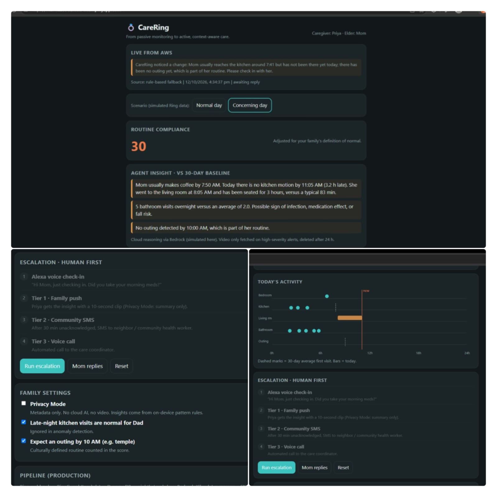
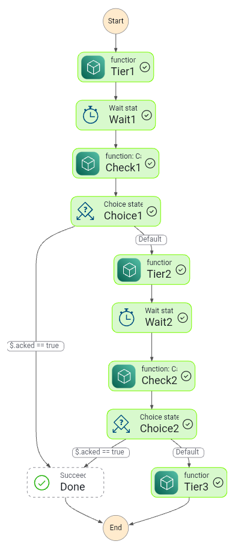
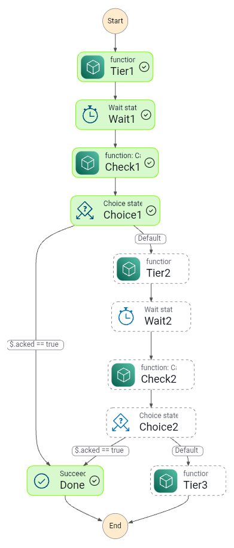
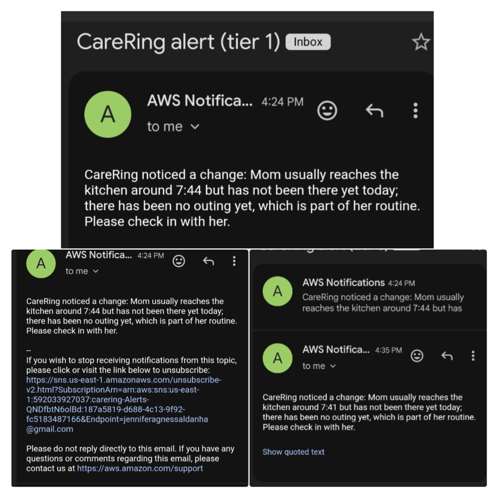

# CareRing

**Software that turns the Ring cameras and doorbells a family already owns into gentle, human-first care for an elder living alone.**

No new hardware. CareRing receives signed Ring motion events, learns each elder's normal routine, explains meaningful changes in plain language, and escalates to people (family first, then a neighbor or community health worker) instead of sounding false alarms.

**Live demo:** https://main.d2096di6el34ri.amplifyapp.com/
**Built for:** Build, Ship, Shape: Amazon Developer Hackathon, Ring track.



## What it does

- **Ring webhook receiver.** Accepts Ring Partner API v1.1 motion webhooks, verifies the `X-Signature` header (HMAC-SHA256 over the raw body), ignores duplicate events by event ID, and maps each Ring device to a room.
- **30-day baseline.** Learns the first kitchen visit, outings and overnight bathroom trips, then compares today against it.
- **Plain-language insight.** For example: "Mom usually reaches the kitchen around 7:44 but has not been there yet today." It never states a diagnosis.
- **Cultural routine engine.** Ramadan, Sunday temple and Diwali settings change what counts as normal.
- **Medicine and meal schedule.** Meals are checked against kitchen activity, tablets need a confirmation, and reminders are spoken aloud.
- **Reverse check-in.** Mom can ask for help herself with one tap.
- **Human-first escalation.** AWS Step Functions escalates through three tiers. One acknowledgement stops the chain.
- **Privacy and consent first.** A consent screen explains what is watched, Mom can pause monitoring with one tap, and she can withdraw consent at any time. Video, audio and photos are never used.
- **Roles.** Primary caregiver, sibling, neighbor and doctor views show different information (simulated, no sign-in yet).
- **Safety extras.** Weather and umbrella advice, water intake, a motion-based inactivity check, device battery reminders, a weekly trend report, a neighbor emergency contact and an Alexa-style voice check-in simulation.
- **Day Ring.** An animated 24-hour view of the day, which pulses when a Ring event arrives.


## Architecture

```
Ring Partner API webhook (or ring-sandbox emulator)
        |  X-Signature (HMAC-SHA256)
   Ingest (Lambda URL) -- verify, dedupe, device -> room --> DynamoDB events (40-day TTL)
                                                              |
                          Analyze (nightly Lambda, 30-day baseline, cultural calendar)
                             |-- Amazon Bedrock reasoning (rule-based fallback)
                             v
              DynamoDB latest insight --> Insight / Api (Lambda URLs) --> dashboard (Amplify)
                             |
                Step Functions escalation: tier 1 -> wait -> acknowledged? -> tier 2 -> wait -> tier 3
                             |
                          Amazon SNS (email, optional SMS)
```

Everything is serverless and pay-per-use, defined in `template.yaml` (AWS SAM).

## Repo layout

| Path | Purpose |
|---|---|
| `template.yaml` | SAM template: tables, Lambdas, state machine, SNS topic |
| `src/ingest.py` | Ring webhook receiver (signature check, dedupe, device to room) |
| `src/analyze.py` | Baseline, deviation detection, cultural calendar, reasoning, escalation trigger |
| `src/escalate.py` | Tiered alerts and the acknowledge link |
| `src/api.py` | Calendar mode and the help button |
| `src/insight.py` | Latest insight and latest Ring event for the dashboard |
| `src/simulate.py` | Seeds a simulated 30-day baseline |
| `tools/send_ring_event.py` | Sends a signed Ring-style test webhook |
| `tools/apply_ui.py` | Dashboard upgrade patcher |
| `web/index.html` | Dashboard |

## Run it yourself

Requires an AWS account, the AWS CLI, the SAM CLI and Python.

```bash
sam build
sam deploy --guided          # set FamilyPhone, CHWPhone, RingHmacKey, DeviceRooms
sam remote invoke Simulate --stack-name carering --event-file event.json   # {"concerning_today": true}
sam remote invoke Analyze --stack-name carering
```

Subscribe an email address to the `Alerts` SNS topic and confirm it. Set `Tier2WaitSeconds=20` for a quick demo.

### With the Ring emulator

```bash
pip install ring-sandbox
ring-sandbox serve --port 8787 --token secret
ring-sandbox webhook <IngestUrl> --key <RingHmacKey>
ring-sandbox inject --device <device-id> --type motion_detected --sub-type human
```

Map the emulator's device IDs to rooms in the `DeviceRooms` parameter, for example `{"<doorbell-id>":"front_door","<camera-id>":"kitchen"}`. To test "Mom replies", open the `AckUrl` output with `?elder=mom` before the wait ends, and the escalation stops at Done.

To remove everything: `sam delete`.

## Screenshots

| Escalation (all tiers) | Mom replied |
|---|---|
|  |  |



## What was built during the hackathon

CareRing was started and built during the hackathon period (first commit October 12, 2026). This includes the whole AWS backend, the Ring webhook receiver and its emulator integration, the escalation flow and the dashboard.

## Honest limits

- **Ring devices are emulated.** Events come from a Ring API emulator (`ring-sandbox`), not from a physical Ring device. The emulator has no kitchen camera, so one of its cameras stands in for the kitchen.
- **The 30-day baseline is simulated.** Only today's events can come from the emulator.
- **Reasoning is rule-based in the live demo.** The Amazon Bedrock path is written, but the demo account was blocked from calling models.
- **Processing is in the cloud today.** On-device processing is planned, not built. Privacy mode pauses sharing in the dashboard.
- **Battery levels, water intake and the weekly trend are simulated.** Ring cannot measure water, and the movement check cannot detect impact or falls.
- **Roles and the Alexa-style check-in are simulations.** No sign-in, Echo device or Alexa skill is connected.
- **Voice is the browser's text to speech,** not Alexa and not a Ring Chime.
- **Reminders and "family notified" messages on the schedule card are display only.**
- The webhook is signed, but the other endpoints are open for the demo. Add authentication and per-family tokens before real use.
- Not a medical device, and not a replacement for emergency services.

## License

MIT. See `LICENSE`.
